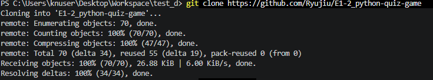
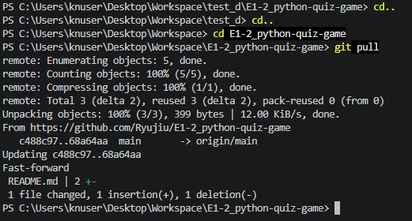
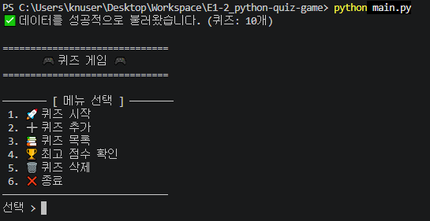
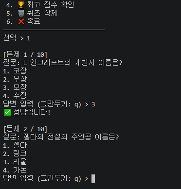
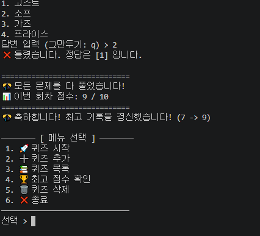
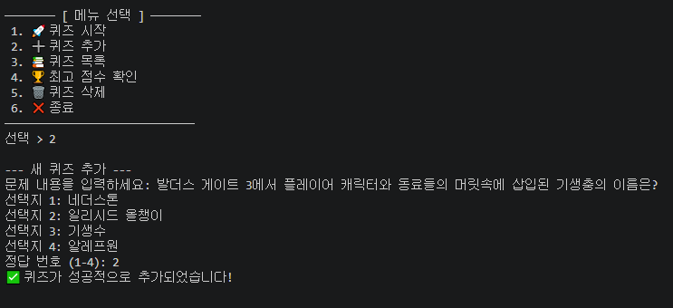
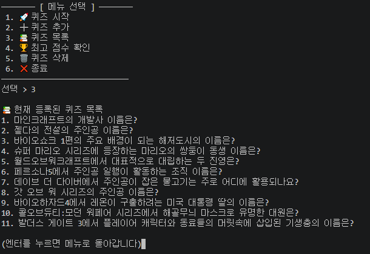
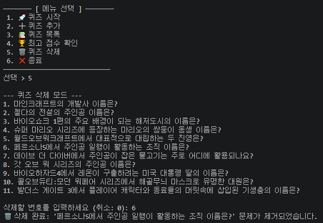
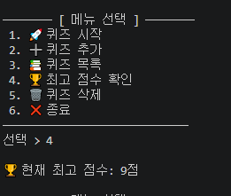

# 🎮 Python 퀴즈 게임  
파이썬으로 제작된 터미널 기반의 퀴즈 게임 프로그램입니다. 게임 관련 상식을 퀴즈로 풀 수 있으며, 사용자가 직접 문제를 추가하거나 삭제하며 자신만의 퀴즈 데이터베이스를 관리할 수 있습니다.  

## 📝 프로젝트 개요  
객체 지향 프로그래밍(OOP)의 핵심 개념인 클래스와 캡슐화를 적용하고, JSON 파일 입출력을 통해 데이터의 영속성을 유지하는 방법을 학습하기 위해 제작되었습니다.  

## 🎯 퀴즈 주제와 선정 이유  
*   **주제:** 비디오 게임 
*   **선정 이유:** 제작자가 평소 깊은 관심을 가지고 있는 분야를 주제로 선정하여, 데이터(퀴즈) 구성 과정에서 흥미를 높이고 실제 사용자 입장에서 재미있게 즐길 수 있는 문제를 담고자 했습니다.  

## 🚀 실행 방법  
1.  **파이썬 설치:** Python 3.6 이상의 버전이 설치되어 있어야 합니다.  
2.  **저장소 클론 또는 파일 다운로드:**  
    깃허브 E1-2_python-quiz-game 레파지토리 통해 다운로드  
    `git clone https://github.com/Ryujiu/E1-2_python-quiz-game`  
3.  **프로그램 실행:**
    터미널에서 `python main.py` 입력  


## ✨ 기능 목록  
*   **퀴즈 시작:** 등록된 퀴즈를 풀고 실시간으로 정답 여부를 확인합니다.  
*   **퀴즈 추가:** 새로운 문제, 선택지, 정답 번호를 입력하여 퀴즈를 확장합니다.  
*   **퀴즈 목록 보기:** 현재 저장된 모든 퀴즈의 질문 리스트를 확인합니다.  
*   **최고 점수 확인:** 역대 최고 점수를 확인하고 경신 시 축하 메시지를 출력합니다.  
*   **퀴즈 삭제:** 번호를 선택하여 기존 퀴즈를 삭제합니다.  
*   **데이터 자동 저장/로드:** 오류 발생 및 강제 종료시 `state.json`에 실시간 저장되어 재시작해도 유지됩니다.  
*   **예외 처리:** 잘못된 숫자 입력이나 문자 입력 시 경고 메시지 출력, Ctrl+C 강제 종료 시에도 현재까지의 데이터를 안전하게 저장 후 종료 

## 🏗️ 클래스 설계 및 역할 (Class Responsibilities)

프로그램의 유지보수와 확장성을 위해 **데이터(Quiz)**와 **로직(QuizGame)**의 역할을 명확히 분리하여 설계했습니다.

### 1. Quiz 클래스 (재사용성 Reusability)
역할: 개별 퀴즈 데이터의 구조를 정의하는 '설계도' 역할을 합니다.  
주요 책임:  
퀴즈 문항(질문), 정답, 선택지 데이터를 보유합니다.  
사용자가 입력한 답이 정답인지 확인하는 기초적인 검증 로직을 가집니다.  
설계 의도 (Why): 동일한 속성을 가진 퀴즈 객체를 반복적으로 생성할 수 있도록 재사용성을 극대화했습니다. 이를 통해 수백 개의 문제를 추가하더라도   코드의 중복 없이 일관된 구조로 데이터를 관리할 수 있습니다.  

### 2. QuizGame 클래스 (추상화 Abstraction)  
역할: 전체적인 게임의 흐름(Flow)을 제어하는 '엔진' 역할을 합니다.  
주요 책임:  
여러 개의 Quiz 객체를 리스트로 관리하고 게임 프로세스를 제어합니다.  
점수 계산, 데이터 로드/저장, 사용자 인터페이스 출력을 전담합니다.  
설계 의도 (Why): 복잡한 내부 로직(파일 입출력, 예외 처리, 점수 합산 등)을 클래스 내부로 감추는 추상화를 적용했습니다. 사용자는 내부 원리를 몰라도   start_game()과 같은 단순한 인터페이스만으로 게임을 완벽하게 조작할 수 있어 프로그램의 복잡도가 낮아집니다.  

## 🏗️ 시스템 아키텍처 및 책임 분리

본 프로젝트는 각 기능의 독립성을 보장하고 유지보수를 용이하게 하기 위해 책임을 다음과 같이 분리하여 설계하였습니다.

### 1. 기능별 책임 (Responsibilities)
| 구분 | 책임 설명 | 주요 역할 |  
| :--- | :--- | :--- |  
| **입력 검증 (Validation)** | 사용자의 입력값이 유효한지 확인 | 비정상적인 입력(문자열 입력, 범위 초과 등)으로부터 시스템 보호 |  
| **게임 진행 (Logic)** | 전체적인 게임의 흐름과 상태 관리 | 퀴즈 순서 제어, 점수 계산, 승리 조건 판단 |  
| **데이터 I/O (Persistence)** | 외부 저장소와의 데이터 교환 | JSON 파일 읽기/쓰기, 데이터 변환(Parsing) 전담 |  

### 2. 호출 흐름 (Call Flow)  
프로그램이 실행될 때 각 모듈은 아래와 같은 흐름으로 상호작용합니다.  

1. **데이터 로드**: `Game Logic`이 시작될 때 `Data I/O`를 호출하여 JSON 파일에서 퀴즈 데이터를 가져옵니다.  
2. **사용자 입력**: `Game Logic`이 사용자에게 답을 요구합니다.  
3. **유효성 검사**: 사용자가 입력한 값은 즉시 `Validation` 모듈로 전달되어 검증을 거칩니다.  
   - *부적절한 값일 경우*: `Game Logic`으로 에러를 반환하고 재입력을 요구합니다.  
   - *적절한 값일 경우*: 다음 단계로 진행합니다.  
4. **상태 업데이트**: 검증된 값을 바탕으로 `Game Logic`이 점수를 계산하고 다음 문제로 넘어갑니다.  
5. **데이터 저장**: 게임 종료 시 `Game Logic`은 최종 결과를 `Data I/O`에 전달하여 JSON 파일에 기록합니다.  

## 🛠️ 유지보수 및 확장 가이드 (Maintenance Guide)  
프로그램의 요구사항이 변경될 경우, 수정해야 할 핵심 위치를 정리하여 유지보수 효율성을 높였습니다.  

| 변경 요구사항 | 수정 대상 (클래스/메서드) | 영향 범위 및 설명 |  
| :--- | :--- | :--- |
| **점수 계산 방식 변경** | `QuizGame` / `update_best_score` | 점수 합산 로직, 최고 점수 판정 기준 및 결과 출력 화면에 영향 |  
| **퀴즈 모델 속성 추가** | `Quiz` / `__init__` | 질문, 정답 외에 '난이도'나 '해설' 등 새로운 데이터 필드 정의 |  
| **데이터 저장 방식 변경** | `QuizGame` / `load_state`, `save_state` | JSON 파일 대신 DB나 다른 포맷을 사용할 때 이 메서드만 수정 |  
| **UI 문구 및 메뉴 수정** | `main.py` / `main` 루프 및 각 메뉴 함수 | 사용자에게 보여지는 터미널 텍스트 및 메뉴 구성 변경 |  

## 📂 파일 구조
.
├── main.py # 프로그램 실행 메인 로직 및 Quiz/QuizGame 클래스  
├── state.json # 퀴즈 데이터 및 최고 점수 영구 저장 파일  
└── README.md # 프로젝트 설명 문서  

## 💾 데이터 관리 (state.json)
본 프로그램은 JSON 형식을 채택하여 데이터의 영속성을 유지하며, 다음과 같은 역할을 수행합니다.

선택 이유: 데이터 영속성 유지, 가독성이 높고 구조화된 데이터 저장에 최적화되어 있습니다.
주요 역할: 퀴즈 리스트 보관, 최고 점수 기록, 비정상 종료 시 자동 복구 지원. 

## 🛡️ 데이터 관리 및 복구 가이드 (Data Management)  
본 프로젝트는 파일 기반 저장 방식을 사용하며, 데이터 유실 방지를 위해 다음과 같은 관리 절차를 권장합니다.  

### 1. 시스템 차원의 자동 대응 (현재 구현)  
*   **파일 부재 시 자동 초기화**: 실행 시 `state.json` 파일이 없거나 손상된 경우, 프로그램이 크래시(Crash)되지 않도록 기본 데이터 구조(Empty   State)를 생성하여 즉시 서비스를 지속합니다.  

### 2. 수동 백업 및 복구 절차 (사용자 가이드)  
데이터의 안전한 보존을 위해 사용자는 다음 절차를 따를 수 있습니다.  
*   **백업(Backup)**: 중요한 퀴즈 데이터를 대량으로 추가한 경우, `state.json` 파일을 `state_backup.json` 등의 이름으로 복사하여 별도 보관합니다.  
*   **복구(Recovery)**:   
    1. 프로그램 종료 후, 손상된 `state.json` 파일을 삭제합니다.  
    2. 미리 보관해둔 백업 파일의 이름을 `state.json`으로 변경합니다.  
    3. 프로그램을 재실행하면 백업 시점의 데이터가 복원됩니다.  


## 📊 데이터 스키마 (Schema)  
```
{
    "quizzes": [
        {
            "question": "퀴즈의 질문 내용 (String)",
            "choices": ["1번보기", "2번보기", "3번보기", "4번보기"],
            "answer": "정답 번호 (Integer, 1~4)"
        }
    ],
    "best_score": "역대 최고 점수 (Integer)",
    "in_progress": {
        "current_index": "현재 풀고 있는 문제 번호 (Integer)",
        "current_score": "현재까지 맞춘 개수 (Integer)"
    }
}
```

## 🚀 성능 분석 및 대량 데이터 처리 방안 (Scalability Analysis)  

현재 시스템은 소규모 데이터(퀴즈 100개 미만)에 최적화되어 있습니다. 데이터가 1,000개 이상으로 급증할 경우 발생할 수 있는 성능 병목 현상과 이에   대한 기술적 해결 방안을 다음과 같이 분석하였습니다.  

### 1. 현재 구조의 한계점  
*   **메모리 효율성**: `json.load()`를 통해 파일 전체를 메모리에 올리므로, 데이터 양에 비례하여 RAM 사용량이 선형적으로 증가합니다.  
*   **검색 및 접근 속도**: 특정 문제를 찾거나 삭제할 때 리스트 순회 방식(`O(n)`)을 사용하므로, 데이터가 많아질수록 응답 시간이 길어집니다.  
*   **I/O 오버헤드**: 단 하나의 데이터만 수정/추가해도 파일 전체를 다시 쓰는 방식이므로 디스크 I/O 부하가 발생합니다.  

### 2. 대량 데이터 대응을 위한 확장 전략  
데이터 규모가 커질 경우, 시스템 안정성을 위해 다음과 같은 개선안을 적용할 수 있습니다.  

*   **인덱싱(Indexing) 도입**:   
    *   현재의 List 구조를 **Dictionary(Hash Map)** 구조로 변경하여 퀴즈 ID를 통한 접근 속도를 `O(1)`으로 최적화합니다.  
*   **페이지네이션(Pagination) 구현**:   
    *   `view_quiz_list` 기능 실행 시 전체를 출력하지 않고, 한 페이지당 10~20개씩 끊어서 출력하여 터미널 렌더링 부하를 줄입니다.  
*   **데이터베이스(DB) 전환**:   
    *   JSON 파일 대신 **SQLite**와 같은 경량 관계형 데이터베이스를 도입합니다. 이를 통해 필요한 데이터만 부분적으로 로드(Lazy Loading)하고,   쿼리를 통해 효율적인 검색과 수정을 수행할 수 있습니다.  

## 🛠 Git 커밋 컨벤션 (Git Commit Convention)  
프로젝트의 변경 이력을 명확히 관리하기 위해 다음과 같은 커밋 규칙을 준수합니다.  

### 1. 커밋 단위 기준
- **기능 단위 커밋**: 하나의 커밋에는 하나의 기능 구현(또는 수정)만 포함합니다.  
- **작동 가능한 코드**: 빌드 오류가 없는 상태에서만 커밋합니다.  
- **문서화**: README 수정이나 주석 추가도 별도의 커밋으로 분리합니다.  

### 2. 커밋 메시지 템플릿 (Commit Message Template)
커밋 메시지는 `[타입] 요약` 형태로 작성합니다.  

| 타입 | 설명 | 예시 |  
| :--- | :--- | :--- |  
| **Feat** | 새로운 기능 추가 | `[Feat] 퀴즈 삭제 기능 추가` |  
| **Fix** | 버그 수정 | `[Fix] JSON 저장 시 발생하는 경로 오류 수정` |  
| **Docs** | 문서 수정 (README 등) | `[Docs] Git 컨벤션 섹션 추가` |  
| **Refactor** | 코드 리팩토링 (기능 변경 없음) | `[Refactor] QuizGame 클래스 로직 최적화` |  
| **Style** | 코드 포맷팅 (세미콜론, 공백 등) | `[Style] 코드 들여쓰기 수정` |  

> **💡 참고 (Retrospective)**
> 본 프로젝트에서는 커밋 규칙이 엄격히 적용되지 않았으나, 
> 프로젝트의 유지보수성과 협업 효율성을 높이기 위해 **2026-11-16**부터 위 컨벤션을 확립하였습니다. 
> 향후 다른 과제 및 프로젝트 진행 시에는 해당 규칙을 철저히 준수할 예정입니다.

# Git 실습완료 26.11.15 16:20
# Git 실습완료 26.11.16 16:13 실습 증거자료 제출을 위한 재실습
# 제출물 스크린샷
Git Clone&Pull  
  
  
  

Git log --oneline --graph  
  

프로그램 실행 관련 스크린샷  
  
  
  
  
  
  
  
